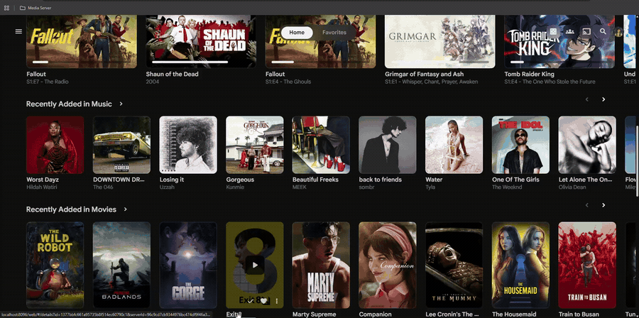
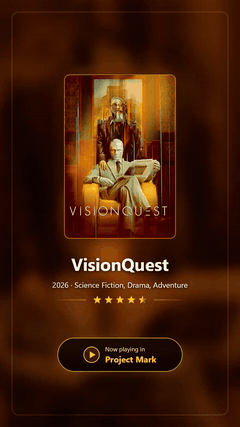
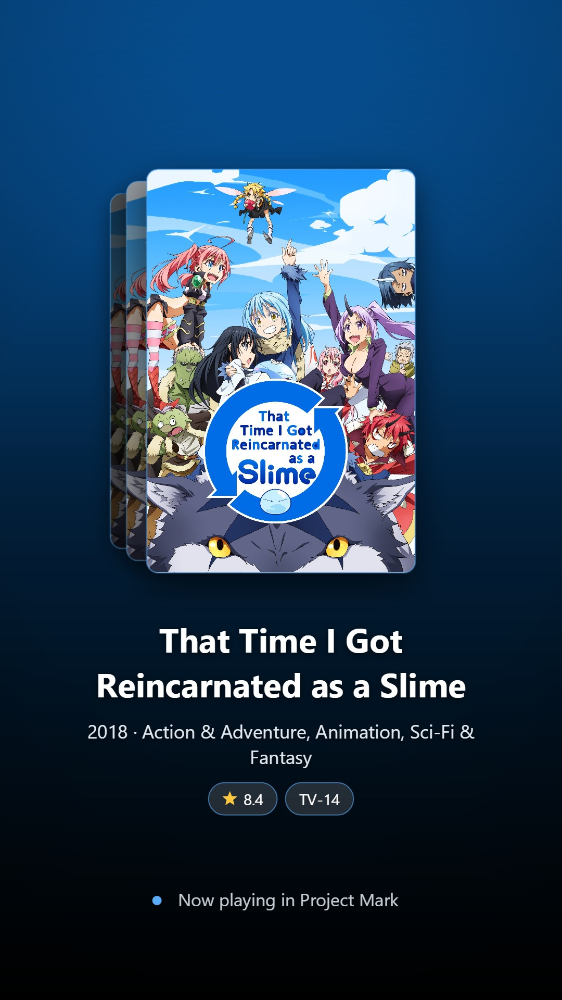

<p align="center">
  
</p>

<p align="center">
  <strong>Turn your Jellyfin library into Instagram-ready story cards.</strong><br>
  A Jellyfin plugin that renders movies, shows, episodes, albums, and tracks as
  1080×1920 stills or looping videos.
</p>

<p align="center">
  <a href="#quick-start">Quick Start</a> ·
  <a href="docs/installation.md">Installation</a> ·
  <a href="docs/configuration.md">Configuration</a> ·
  <a href="docs/user-guide.md">User Guide</a> ·
  <a href="docs/troubleshooting.md">Troubleshooting</a>
</p>

Story Share adds a share button to Jellyfin item pages. Choose a layout, background,
optional caption, and output format; the plugin renders a vertical card from the item's
own artwork and metadata. Save the file to your phone and post it wherever you like.
Story Share does not publish to social media.

## Preview

[](docs/demo.mp4)

The Story dialog on an item page: style and background selection, video output,
animation, and an optional tagline caption. [Watch the full-quality demo](docs/demo.mp4).

<table>
<tr>
<td width="33%" valign="top"><a href="docs/samples/review.mp4"></a></td>
<td width="33%" valign="top"><a href="docs/samples/stack.jpg"></a></td>
<td width="33%" valign="top"><a href="docs/samples/fullbleed-pulse.mp4"></a></td>
</tr>
<tr>
<td valign="top"><b>Review</b><br>Poster, star score, and caption as a review.</td>
<td valign="top"><b>Stack</b><br>Artwork arranged as a pile of cards.</td>
<td valign="top"><b>Full bleed + Pulse</b><br>Artwork to every edge, with drifting light.</td>
</tr>
</table>

The sample footer reads *Project Mark* because that was the name of the server used to
render them. Your cards use your own server name.

## Quick Start

**Requirements:** Jellyfin 12.1.x on .NET 10 with the standard web client. Video output
also needs ffmpeg configured on the server; Jellyfin includes and configures one by
default.

1. In Jellyfin, open **Dashboard → Plugins → Repositories**, select **+**, and add this
   repository URL:

   ```text
   https://raw.githubusercontent.com/markdanielaguinaldo/StoryShare/main/manifest.json
   ```

2. Open **Catalog**, find **Story Share** under **General**, and install it.
3. Restart Jellyfin.
4. Hard-refresh the web client (<kbd>Ctrl</kbd>+<kbd>Shift</kbd>+<kbd>R</kbd>) so the
   plugin's script is loaded.
5. Open a movie, show, episode, album, or track and select the share icon in the detail
   button row.
6. Pick a style, background, format, and animation, add a caption if you want one, then
   use **Go to URL** to open the card on your phone.

Set **Public base URL** in **Dashboard → Plugins → Story Share** before opening share
links from outside your network. For manual installs, upgrades, and compatibility, see
the [installation guide](docs/installation.md).

## Features

- **Nine card styles** — Poster, Full bleed, Vibe Meter, Polaroid, Vinyl, Stack, Ticket,
  Crate, and Review.
- **Story-ready output** — 1080×1920 JPEG stills or H.264 MP4 videos sized for Stories.
- **Three animation modes** — Auto, Float, and Pulse, plus Vinyl's record spin.
- **Backgrounds** — sixteen presets, a custom colour, or a palette matched to the artwork.
- **Captions** — free text, with a one-click suggestion from the item's tagline when one
  exists.
- **Vibe Meter** — five playful, metadata-derived scores you can adjust, with animated
  meter fills.
- **Server branding** — footer text with a `{server}` placeholder, an accent colour, and
  a custom logo for Full bleed.
- **Share button** — added to jellyfin-web item pages without modifying files on disk.
- **Signed links** — short-lived, HMAC-signed URLs for opening and saving cards on a
  phone.
- **In-memory cache** — keeps finished renders so previewing and opening the same card
  does not draw it twice.

Story Share creates the file; it does not post to Instagram or any other service.

## Documentation

| Guide | Contents |
| --- | --- |
| [Installation](docs/installation.md) | Requirements, catalog and manual installation, upgrades, compatibility |
| [Configuration](docs/configuration.md) | Every plugin setting, share-link options, cache controls |
| [User Guide](docs/user-guide.md) | Styles, backgrounds, artwork fitting, animation, captions, saving to a phone |
| [Troubleshooting](docs/troubleshooting.md) | Missing button, broken links, video failures, iOS saving, logs |
| [Development and API](docs/development.md) | Build and release flow, dev harness, API endpoints, architecture notes |

## Security

- Share links are HMAC-signed and expire. The default lifetime is 60 minutes and can be
  set from 5 minutes to 7 days.
- Anyone who has a share URL can open that card until it expires. Treat the URL as a
  bearer token and use HTTPS for the public base URL.
- The signing key is generated on first run and stored in the plugin configuration.
  Rotating or deleting it invalidates every outstanding share link.
- Card endpoints require a normal Jellyfin token. The anonymous routes are the
  signature-gated public card route and the static web-client script.
- Story Share does not publish to social media.

## License

MIT.
